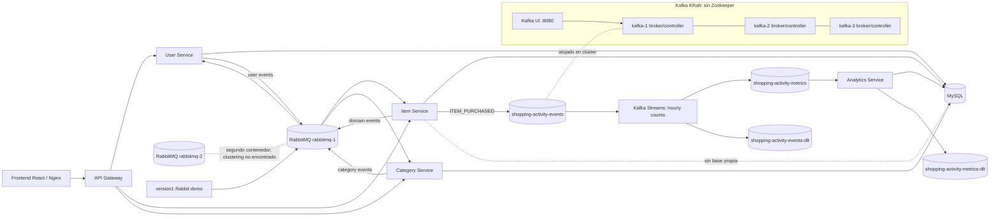
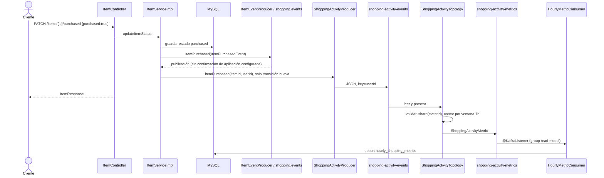
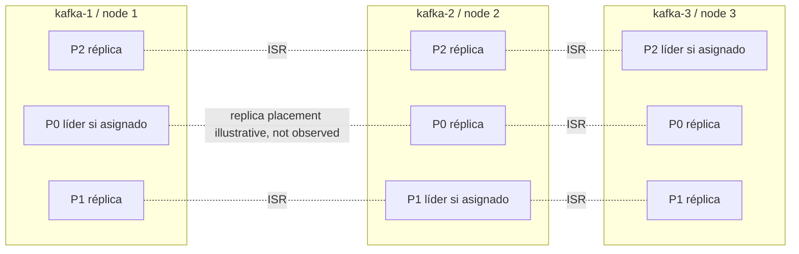

# Documentación de arquitectura

> Alcance: inspección estática de archivos fuente y `docker-compose.yml` del repositorio. No se ejecutaron contenedores ni se verificó un clúster vivo. Todas las afirmaciones describen código/configuración encontrado. Las credenciales se sustituyen por `[OCULTO]`.

## 1. Resumen ejecutivo

El producto es una aplicación de lista de compras: frontend React, gateway Spring Cloud y servicios de usuarios, ítems y categorías; (evidencia: `frontend/src/VistaPrincipal.tsx`, `DCNBackend-Mysql/api-gateway/src/main/resources/application.properties`, controladores de cada servicio).
`item-service` genera actividad de compras y Kafka Streams la agrega por hora en 16 shards; (evidencia: `item-service/.../ShoppingActivityProducer.java`, `analytics-service/.../ShoppingActivityTopology.java`).
Kafka funciona como registro distribuido de actividad y base de entrada del cálculo analítico; RabbitMQ distribuye eventos de dominio entre servicios para sincronización y notificaciones; (evidencia: productores/consumidores Rabbit y Kafka citados en §§7–10 y 13).
La infraestructura declara tres nodos Kafka en modo KRaft, dos contenedores RabbitMQ, MySQL, Kafka UI, cinco servicios backend, un servicio Rabbit de demostración y frontend; no declara Zookeeper; (evidencia: `docker-compose.yml`).
Las compras persisten en MySQL antes de publicar; las métricas también se guardan en tabla MySQL; (evidencia: `ItemServiceImpl.java`, `HourlyMetricConsumer.java`, `schema.sql`).
Los endpoints de dominio y analítica están protegidos por JWT Azure; los endpoints de `version1` se configuran por separado; (evidencia: clases `SecurityConfig.java` y `SecurityConfiguration.java`, `version1/application.properties`).

## 2. Mapa del repositorio

```text
.
├── docker-compose.yml                 # Orquesta infraestructura, backend y frontend.
├── rabbitmq.conf                      # Configuración montada en ambos RabbitMQ.
├── frontend/                          # UI React/Vite, empaquetada con Nginx.
└── DCNBackend-Mysql/
    ├── api-gateway/                   # Enruta /users, /items y /categories.
    ├── user-service/                  # CRUD de usuarios y eventos de usuario por RabbitMQ.
    ├── item-service/                  # CRUD de ítems; eventos Rabbit y actividad de compra Kafka.
    ├── category-service/              # CRUD de categorías y consumidor de eventos de ítems.
    ├── analytics-service/             # Kafka Streams, persistencia de métricas y API AdminClient.
    ├── version1/                       # Servicio RabbitMQ de demostración: mensajes, recursos y listeners.
    ├── datos.sql                       # Datos/DDL SQL auxiliares; no se referencia desde Compose.
    └── endpoints.md                   # Notas de endpoints; algunas rutas de controladores citan ubicaciones antiguas.
```

El backend se organiza como módulos Spring Maven independientes, no se encontró un POM agregador en raíz. La base de datos compartida por Compose crea varias bases al conectar cada servicio con `createDatabaseIfNotExist=true`; `version1` usa su propia configuración JDBC. Evidencia: `docker-compose.yml`, `*/src/main/resources/application.properties`.

## 3. Infraestructura (`docker-compose.yml`)

| Servicio | Imagen/build | Puertos host:contenedor | Rol | Dependencias declaradas |
|---|---|---:|---|---|
| `rabbitmq-1` | `rabbitmq:3.12-management-alpine` | 5672:5672, 15672:15672 | RabbitMQ principal configurado para management | Ninguna |
| `rabbitmq-2` | misma | 5673:5672, 15673:15672 | Segundo nodo/contenedor RabbitMQ | `rabbitmq-1` |
| `kafka-1` | `apache/kafka:4.4.0` | 19092:19092 | Nodo Kafka KRaft id 1, broker y controller | No declaradas |
| `kafka-2` | misma | 29092:29092 | Nodo Kafka KRaft id 2, broker y controller | No declaradas |
| `kafka-3` | misma | 39092:39092 | Nodo Kafka KRaft id 3, broker y controller | No declaradas |
| `kafka-ui` | `provectuslabs/kafka-ui:v0.7.2` | 8080:8080 | UI para el clúster `dcn-local` | Los tres Kafka |
| `mysql` | `mysql:8` | 3307:3306 | Persistencia relacional | Ninguna |
| `api-gateway` | build `DCNBackend-Mysql/api-gateway` | 8089:8089 | Entrada HTTP a servicios de dominio | user, item, category |
| `user-service` | build local | 8081:8081 | Usuarios | mysql, rabbitmq-1 |
| `item-service` | build local | 8082:8082 | Ítems y eventos de compra | mysql, rabbitmq-1, tres Kafka |
| `category-service` | build local | 8083:8083 | Categorías | mysql, rabbitmq-1 |
| `analytics-service` | build local | 8084:8084 | Streams, métricas y administración Kafka | mysql, tres Kafka |
| `rabbit-service` | build `DCNBackend-Mysql/version1` | 9090:9090 | API de gestión y prueba RabbitMQ | rabbitmq-1, mysql |
| `frontend` | build `frontend` | 80:80 | UI servida por Nginx | api-gateway |

**Kafka:** hay tres nodos broker/controller combinados; Zookeeper: **NO ENCONTRADO**. `KAFKA_NODE_ID` distingue nodos 1–3; `KAFKA_PROCESS_ROLES=broker,controller`; `KAFKA_CONTROLLER_QUORUM_VOTERS` enumera los tres en 9093. El listener interno usa 9092 y el externo puertos 19092/29092/39092, todos `PLAINTEXT`. Valores declarados: replication factor por defecto 3, `min.insync.replicas=2`, offsets replication 3, transaction log replication 3/min ISR 2 y 3 particiones por defecto. Para escrituras con `acks=all`, perder un nodo aún permite progreso si quedan al menos dos réplicas sincronizadas; con menos de dos ISR, escrituras que respeten min ISR pueden fallar. Pérdida de quorum de controllers puede impedir cambios de metadata. Evidencia: `docker-compose.yml`, bloque `kafka-node`.

**RabbitMQ:** hay dos contenedores, pero no se encontró configuración de join/cluster, peer discovery, replicated queue policy ni healthcheck. Por lo tanto no se puede afirmar que formen un clúster ni que las colas sobrevivan a caída de `rabbitmq-1`; Compose conecta ambos a `rabbitmq_cluster`, pero los servicios de aplicación apuntan a `rabbitmq-1`. Los puertos management son 15672/15673. Evidencia: `docker-compose.yml`, `rabbitmq.conf`.

`depends_on` ordena arranque pero no prueba disponibilidad de la base o broker; no hay `healthcheck` declarado. Las credenciales declaradas en Compose/properties se omiten aquí como `[OCULTO]`. Hay dependencia `rabbit-service -> mysql`, pero el servicio no declara build de script que cree `rabbit_db`; su URL crea DB al conectar si MySQL acepta usuario. En Compose se configura `MYSQL_DATABASE` distinto; el nombre indicado por la app no se crea en inicialización, aunque la URL pide creación automática. Evidencia: Compose y `version1/application.properties`.

## 4. Tópicos Kafka

Los nombres se obtienen de `analytics-service/src/main/resources/application.properties`. Las propiedades comunes `KafkaConsumerConfiguration.topic()` fijan 3 particiones, 3 réplicas, retention 604800000 ms (7 días), `cleanup.policy=delete`, `min.insync.replicas=2`.

| Nombre | Particiones | Réplicas | Retención | cleanup.policy | Otras configs | Creación | Productor | Consumidor |
|---|---:|---:|---|---|---|---|---|---|
| `shopping-activity-events` | NO ENCONTRADO en código; default del broker declarado 3 | NO ENCONTRADO como config explícita; default declarado 3 | default broker no explícito en Compose; valor efectivo NO ENCONTRADO | NO ENCONTRADO | `min.insync.replicas` default broker 2 | NO ENCONTRADO declarativamente; Streams lo lee | `ShoppingActivityProducer.itemPurchased` | `ShoppingActivityTopology` |
| `shopping-activity-metrics` | 3 | 3 | 7 días | delete | min ISR 2 | bean `metricsTopic` | Kafka Streams `to(outputTopic)` | `HourlyMetricConsumer` |
| `shopping-activity-events-dlt` | 3 | 3 | 7 días | delete | min ISR 2 | bean `invalidActivityTopic` | rama inválida de `ShoppingActivityTopology` | No hay listener; queda retenido para inspección |
| `shopping-activity-metrics-dlt` | 3 | 3 | 7 días | delete | min ISR 2 | bean `metricsDeadLetterTopic` | `DeadLetterPublishingRecoverer` | No hay listener; queda retenido para inspección |

Evidencia de definición y retención: `analytics-service/.../KafkaConsumerConfiguration.java` (constantes y beans). **Distribución real por broker:** no hay asignación fija codificada; Kafka asigna líderes/réplicas en creación. Con 3 brokers y factor 3, cada partición tendrá una réplica en cada nodo si el clúster tiene esos tres disponibles, pero líder y orden efectivos dependen del clúster; no se puede enumerar una distribución viva sin consultar AdminClient/UI.

Tres particiones permiten hasta tres tareas de consumo simultáneas por grupo en ese tópico; factor 3 y min ISR 2 buscan tolerar una caída manteniendo escrituras confirmadas. Siete días es una política explícita de retención finita; el código no explica la elección temporal. Para `shopping-activity-events`, sus parámetros no son configurados por bean, así que no se atribuyen los valores de los otros tópicos.

## 5. Configuración del cliente Kafka

| Microservicio | Bootstrap | Serialización / grupo / offset | Seguridad y propiedades avanzadas | Fuente |
|---|---|---|---|---|
| `item-service` | `SPRING_KAFKA_BOOTSTRAP_SERVERS`; default para host: `localhost:19092,localhost:29092,localhost:39092`, Compose lo reemplaza por `kafka-1:9092,...` | Producer key String, value JSON; no hay consumer Kafka ni group-id declarado | `acks=all`, idempotencia true, retries 5, retry backoff 1000 ms, delivery timeout 120000 ms, request timeout 30000 ms, max in flight 5, sin type headers | `item-service/src/main/resources/application.properties` |
| `analytics-service` consumidor | bootstrap en property/env | Consumer key StringDeserializer, value JsonDeserializer; group `shopping-activity-read-model-v1`; auto commit false; reset earliest | default type `ShoppingActivityMetric`, trusted package `com.shopping_list.analytics.contract`, type headers false. Producer JSON/String, acks all, retries 5, idempotencia, delivery/request timeout; Admin request timeout 10000 | `analytics-service/src/main/resources/application.properties` |
| `analytics-service` Streams | Usa bootstrap y `application.id=shopping-activity-streams-v1` (override por env) | Serdes por defecto String; input y output declaran Serdes explícitos (ver §10) | `processing.guarantee=exactly_once_v2`, replication factor interno 3, standby replicas 1 | `ShoppingActivityTopology.java` |
| `user-service`, `category-service`, `api-gateway`, `version1` | Kafka: **NO ENCONTRADO** en configuración fuente | Kafka producer/consumer/group: **NO ENCONTRADO** | RabbitMQ es aparte | `application.properties` de cada módulo y sus POM; `version1` no incluye spring-kafka |

## 6. Diseño de eventos (DTOs)

### Evento Kafka

`ShoppingActivityEvent` (`item-service/.../ShoppingActivityEvent.java`): `eventId: UUID` id único; `schemaVersion: int` versión; `eventType: String` tipo; `occurredAt: Instant` instante; `itemId: Long` ítem; `userId: Long` usuario. Constructor exige campos no nulos, versión positiva, IDs positivos y tipo no vacío. Se produce en `shopping-activity-events` y se consume/valida en `ShoppingActivityTopology`.

```json
{"eventId":"d290f1ee-6c54-4b01-90e6-d701748f0851","schemaVersion":1,"eventType":"ITEM_PURCHASED","occurredAt":"2026-11-21T14:25:00Z","itemId":42,"userId":7}
```

`ShoppingActivityMetric` (`analytics-service/.../ShoppingActivityMetric.java`): `windowStart: Instant` inicio de ventana; `shard: int` shard; `purchaseCount: long` cantidad acumulada. Exige inicio, shard no negativo y conteo positivo. Tópico `shopping-activity-metrics`; Streams produce y `HourlyMetricConsumer` consume.

```json
{"windowStart":"2026-11-21T14:00:00Z","shard":5,"purchaseCount":12}
```

### Eventos RabbitMQ usados por el dominio

Los eventos referenciados por productores: `ItemCreatedEvent(itemId: Long, userId: Long, name: String)` (`item-service/.../messaging/event/ItemCreatedEvent.java`), `ItemPurchasedEvent(itemId: Long, userId: Long)` (`.../ItemPurchasedEvent.java`), `UserCreatedEvent(userId: Long)`, `UserDeactivatedEvent(userId: Long)`, `UserDeletedEvent(userId: Long)` (`user-service/.../messaging/event/`). `CategoryDeletedEvent` se declara en `category-service`/`item-service` para notificar borrado. Los productores usan JSON con esos campos. Ejemplos representativos:

```json
{"itemId":42,"userId":7,"name":"Leche"}
{"itemId":42,"userId":7}
{"userId":7}
```

Los eventos anteriores van por exchange Rabbit `shopping.events` con routing keys `item.created`, `item.purchased`, `user.created`, `user.deactivated`, `user.deleted` o `category.deleted`; productor/consumidor se detalla en §13. No tienen versión/timestamp declarados en los records citados.

`version1` recibe `MessageRequest(exchange:String, routingKey:String, queueName:String, message:String)` y expone texto recibido como `ConsumedMessage`; fuentes `version1/.../dto/`. No está conectado al flujo Kafka.

## 7. Productores

| Clase/método | Destino y key | DTO y motivo de key | Errores/callback |
|---|---|---|---|
| `item-service/.../ShoppingActivityProducer.itemPurchased(itemId,userId)` | `shopping-activity-events`; key `userId.toString()` | `ShoppingActivityEvent`. La clave agrupa eventos de un usuario en una partición; la topología después vuelve a particionar usando shard derivado de eventId | `CompletableFuture.whenComplete`: log de fallo o topic/partition/offset; `RuntimeException` sincrónica se registra y no se propaga. No hay reintento de negocio/DLT en productor; la config Kafka tiene retries 5 |
| `item-service/.../ItemEventProducer.itemCreated/itemPurchased` | Rabbit `shopping.events`; keys `item.created` y `item.purchased` | `ItemCreatedEvent` o `ItemPurchasedEvent`; routing key selecciona binding | `convertAndSend` y log; no callback de confirmación o catch en productor |
| `user-service/.../UserEventProducer.userCreated/userDeactivated/userDeleted` | Rabbit `shopping.events`; keys `user.created`, `user.deactivated`, `user.deleted` | DTO correspondiente con userId | `convertAndSend` y log; no callback de confirmación o catch en productor |

La clase de servicio confirma el cambio de `purchased` y publica Kafka solo al pasar de no comprado a comprado (`newlyPurchased`); Rabbit `item.purchased` se publica siempre que el estado final sea comprado. Fuente: `item-service/.../ItemServiceImpl.java`.

## 8. Consumidores

No se encontró `@KafkaListener` de negocio en microservicios salvo el read model de analítica. El procesamiento de eventos de origen ocurre con Kafka Streams (`ShoppingActivityTopology`). Para Rabbit:

| Listener | Cola / grupo / concurrencia | Mensaje y delegación |
|---|---|---|
| `analytics-service/.../HourlyMetricConsumer.consume` | `shopping-activity-metrics`, group `shopping-activity-read-model-v1`; concurrency no configurada explícitamente | `ShoppingActivityMetric`; hace upsert JDBC a `hourly_shopping_metrics` usando bucket ventana+shard. Lógica de persistencia está en el componente listener; no se encontró otra capa de caso de uso |
| `item-service/.../UserEventsConsumer.onUserEvent` | `items.user-events.queue`; groupId y concurrency Rabbit no configurados explícitamente | Lee routing key, convierte JSON y actualiza repositorios `DeactivatedUserRepository` y `ItemRepository` en transacción; actúa sobre persistencia directamente |
| `item-service/.../CategoryEventsConsumer.onCategoryDeleted` | `items.category-events.queue`; concurrencia NO ENCONTRADO | `CategoryDeletedEvent`; actualmente solo registra notificación |
| `category-service/.../ItemEventsConsumer.onItemCreated` | `categories.item-events.queue`; concurrencia NO ENCONTRADO | `ItemCreatedEvent`; registra, contiene rechazo especial de demostración para userId 999 |
| `user-service/.../ItemEventsConsumer.onItemPurchased` | `users.item-events.queue`; concurrencia NO ENCONTRADO | `ItemPurchasedEvent`; actualmente solo registra |
| `version1/.../OrderListener.processOrder` | `orders.queue`; `orderListenerFactory`, 3 consumidores iniciales y máximo 5 | String orderId; emite estado `PROCESSING` y `COMPLETED` a WebSocket `/topic/messages`, con pausa de 2 s |

Rabbit no usa `groupId` Kafka; sus colas actúan como destino de balanceo. Hay DLQ listeners documentados en §11. La separación de lógica es parcial: `ItemController` delega a `ItemService`, pero varios consumidores ejecutan lógica/persistencia o solo log dentro del propio listener.

## 9. Consumer groups

| groupId | Microservicio | Tópicos | Paralelismo máximo por particiones | Propósito |
|---|---|---|---:|---|
| `shopping-activity-read-model-v1` | analytics-service | `shopping-activity-metrics` | 3 instancias/consumidores asignados al mismo tiempo (3 particiones; la anotación declara un listener, concurrency sin override) | Balancear persistencia de read model y consultar offset/LAG |
| `shopping-activity-streams-v1` | analytics-service Kafka Streams | `shopping-activity-events` y tópicos internos de Streams | NO DETERMINABLE exactamente sin particiones efectivas del input; config del tópico de entrada no encontrada | Identidad de aplicación, coordinación de tareas y estado de Streams |

Rabbit listeners no tienen groupId Kafka y se excluyen de esta tabla. Evidencia: `HourlyMetricConsumer.java`, `ShoppingActivityTopology.java`, properties de analytics.

## 10. Kafka Streams (analítica de compras)

- Topología/configuración: `analytics-service/src/main/java/com/shopping_list/analytics/stream/ShoppingActivityTopology.java`.
- `application.id`: `shopping-activity-streams-v1`; definido por properties y Compose env.
- Stores: `hourly-shopping-purchases-v1`, una `WindowStore` materializada; retención de estado 7 días.
- Serdes: input String/String; agrupación String y `JsonSerde<ParsedShoppingActivity>`; salida String y `JsonSerde<ShoppingActivityMetric>`. Defaults de Streams String/String.
- Garantía: `exactly_once_v2`; RF de tópicos internos 3; `num.standby.replicas=1`.
- Ventana: tumbling por tamaño de 1 hora con grace de 10 minutos (`TimeWindows.ofSizeAndGrace`); extractor intenta obtener `occurredAt` del JSON y cae al timestamp Kafka si no puede.

Pasos: 1) lee strings de `shopping-activity-events`; 2) parsea/valida JSON con `ShoppingActivityParser`; 3) manda inválidos a `shopping-activity-events-dlt` con detalle de error; 4) conserva válidos y cambia su key a `shard|purchases`, shard = `floorMod(eventId.hashCode(),16)`; 5) agrupa por clave y cuenta eventos por ventana horaria; 6) transforma cada resultado en `ShoppingActivityMetric`; 7) publica en `shopping-activity-metrics`; 8) `HourlyMetricConsumer` hace upsert MySQL.

No se encontró un endpoint REST de lectura de métricas ni consulta Interactive Query. Los resultados se consultan en tabla `hourly_shopping_metrics`; query/endpoint de lectura: **NO ENCONTRADO**. `topology.describe()` invocado/impreso: **NO ENCONTRADO**; sin ejecutar/instanciar Streams no hay salida real para pegar. La descripción lógica anterior sale del builder de topología.

La métrica es conteo de eventos `ITEM_PURCHASED` por ventana y shard, no monto/valor de compra. Campos `itemId` y `userId` se validan, pero el conteo final se agrupa por shard, no por usuario o ítem.

## 11. Manejo de errores y resiliencia

- Entrada de compra validada por constructor de `ShoppingActivityEvent` y, de nuevo, `ShoppingActivityParser`; eventos inválidos no abortan la topología: se registran y publican en `shopping-activity-events-dlt` (`ShoppingActivityTopology.java`, `ShoppingActivityParser.java`).
- Error del consumidor JDBC Kafka: `DefaultErrorHandler` con `DeadLetterPublishingRecoverer` al `shopping-activity-metrics-dlt`; backoff fijo 1000 ms con 2 reintentos (`KafkaConsumerConfiguration.java`).
- Los tópicos DLT de Kafka tienen retención configurada 7 días. No hay consumidor de esos DLTs encontrado.
- Rabbit retry: user/item/category properties declaran habilitado, 3 intentos, intervalo 2000 ms, multiplicador 2, `default-requeue-rejected=false`; mensajes rechazados van a DLQ mediante argumentos `x-dead-letter-*` en colas declaradas por `RabbitConfig`.
- DLQs nombradas: `items.user-events.dlq`, `categories.item-events.dlq`, `users.item-events.dlq`, `items.category-events.dlq`; listeners de DLQ solo se encontraron para las dos primeras en item-service y la de category en category-service. La de `users.item-events.dlq` no tiene `DeadLetterListener` encontrado.
- El listener de `version1` no declara estrategia de retry/DLQ en su fábrica; errores/reintentos efectivos: **NO ENCONTRADO**.
- Deserialization error handler de Kafka separado: **NO ENCONTRADO**. `KafkaConsumerConfiguration` configura handler de errores del listener, no un `ErrorHandlingDeserializer` explícito.
- `ShoppingActivityProducer` atrapa fallo sincrónico y registra error; el endpoint puede devolver éxito después de persistir aunque la publicación falle. No hay outbox transaccional encontrado, por lo que persistencia MySQL y publicación Kafka no son atómicas.
- Los listeners de DLQ imprimen body de mensaje; `version1/MessageService` registra el texto completo recibido. Evitar enviar datos sensibles a estas rutas/logs.

## 12. Microservicio administrador (AdminClient)

La API vive en `analytics-service`, usa `AdminClient` de `KafkaAdmin` (`KafkaAdminClientConfiguration.java`) y está protegida por JWT más scopes `Kafka.Read` o `Kafka.Admin` (`SecurityConfiguration.java`, controladores). Prefijo base `/api/kafka`.

| Método | Ruta | Operación y parámetros | Ejemplo |
|---|---|---|---|
| GET | `/api/kafka/topics` | Lista topics gestionables `shopping-activity-*` / `shopping-analytics-*`; respuesta array de nombres | respuesta `[]` o `[`"shopping-activity-metrics"`]` |
| GET | `/api/kafka/topics/{topic}` | Particiones con líder, réplicas, ISR y configs no sensibles | respuesta `{"name":"shopping-activity-metrics","internal":false,"partitions":[{"partition":0,"leader":1,"replicas":[1,2,3],"inSyncReplicas":[1,2,3]}],"configs":{"retention.ms":"604800000"}}` |
| POST | `/api/kafka/topics` | Crea topic; campos `name`, `partitions` (1–24), `replicationFactor` (2–3 y <= brokers), `retentionMs` (60000–7776000000), `cleanupPolicy` delete/compact; 201 sin cuerpo | `{"name":"shopping-analytics-demo","partitions":3,"replicationFactor":3,"retentionMs":604800000,"cleanupPolicy":"delete"}` |
| PUT | `/api/kafka/topics/{topic}/config` | Cambia solo retentionMs y/o cleanupPolicy; 204 | `{"retentionMs":86400000,"cleanupPolicy":"compact"}` |
| DELETE | `/api/kafka/topics/{topic}` | Elimina topic, body `{"confirmation":"DELETE:shopping-analytics-demo"}`; bloquea topic con consumidores activos; 204 | ver body |
| GET | `/api/kafka/consumer-groups` | Lista grupos gestionables y estado/member count | `[ {"groupId":"shopping-activity-read-model-v1","state":"STABLE","members":1} ]` |
| GET | `/api/kafka/consumer-groups/{groupId}` | Detalla miembros, asignaciones, committed/end offset y lag | `{"groupId":"shopping-activity-read-model-v1","state":"STABLE","members":1,"memberDetails":[],"offsets":[]}` |
| DELETE | `/api/kafka/consumer-groups/{groupId}` | Elimina solo grupo EMPTY/DEAD y no Streams; body `{"confirmation":"DELETE:shopping-activity-read-model-v1"}` | respuesta 204 |

Los ejemplos son formas de respuesta derivadas de records Java, no resultados observados en runtime. El endpoint no es accesible sin token JWT que tenga scope correspondiente. Las configuraciones gestionadas excluyen datos sensibles y filtran nombres por regex.

## 13. RabbitMQ

El flujo de dominio usa exchange durable tipo topic `shopping.events` y exchange durable direct `shopping.dlx`. Los tres servicios (user, item, category) declaran topology equivalente (`*/messaging/config/RabbitConfig.java`); la topología contiene:

| Cola | Binding/routing key | Consumidor | DLQ |
|---|---|---|---|
| `items.user-events.queue` | `user.*` | `UserEventsConsumer` de item-service | `items.user-events.dlq` |
| `categories.item-events.queue` | `item.created` | `ItemEventsConsumer` de category-service | `categories.item-events.dlq` |
| `users.item-events.queue` | `item.purchased` | `ItemEventsConsumer` de user-service | `users.item-events.dlq` |
| `items.category-events.queue` | `category.deleted` | `CategoryEventsConsumer` de item-service | `items.category-events.dlq` |

Productores: `UserEventProducer` publica user.created/deactivated/deleted; `ItemEventProducer` publica item.created e item.purchased; el productor de categoría se declara en `category-service/.../CategoryEventProducer.java` para `category.deleted`. Cada evento permite sincronizar reacciones entre servicios sin llamada HTTP directa: bloqueo de crear ítems cuando usuario está desactivado, limpieza de ítems al borrar usuario y notificaciones. Algunos consumidores solo registran el evento y no persisten cambios (`ItemEventsConsumer` de categorías/usuarios y `CategoryEventsConsumer`).

La DLQ se activa por argumentos en cola y propiedades de retry, pero Compose no demuestra clúster Rabbit replicado. Además, cada aplicación declara exchanges/colas iguales, lo cual es idempotente si los parámetros coinciden.

`version1` es otro uso de RabbitMQ: `orders.queue` durable y `OrderListener` recibe texto orderId, envía estados a WebSocket `/topic/messages`; `MessageController` permite publicar en exchange o cola. `RabbitMQController` administra recursos Rabbit. No participa en Kafka ni en el flujo de compra de los servicios Shopping. Kafka se reserva a actividad de compras/analítica con relectura por offset, tópicos y procesamiento; Rabbit distribuye notificaciones operativas por routing key y colas.

## 14. FLUJOS (diagramas Mermaid)

### a) Arquitectura general



### b) Compra de extremo a extremo



La secuencia muestra llamadas del código; la publicación asíncrona Kafka puede fallar sin hacer fallar la respuesta HTTP. Fuente: `ItemController`, `ItemServiceImpl`, `ShoppingActivityProducer`, `ShoppingActivityTopology`, `HourlyMetricConsumer`.

### c) Topología Kafka Streams

```mermaid
flowchart TD
  S[Source shopping-activity-events: String/String] --> P[ShoppingActivityParser.parse]
  P --> F{valid?}
  F -- no --> D[shopping-activity-events-dlt]
  F -- sí --> K[selectKey: floorMod(eventId.hashCode,16)]
  K --> G[groupByKey]
  G --> W[TimeWindows: 1h, grace 10m]
  W --> C[count]
  C --> ST[(WindowStore hourly-shopping-purchases-v1)]
  ST --> M[map a ShoppingActivityMetric]
  M --> O[Sink shopping-activity-metrics]
  O --> L[HourlyMetricConsumer]
  L --> DB[(MySQL hourly_shopping_metrics)]
```

### d) Distribución de tópicos



El esquema ilustra una posible colocación para RF=3, no el resultado real: el líder de cada partición se consulta con Kafka UI/AdminClient; la asignación no está codificada en el repositorio.

## 15. Cómo ejecutar y demostrar

### Arranque

Desde la raíz (Docker Compose):

```powershell
docker compose up -d --build
docker compose ps
```

El Compose construye los módulos incluidos en su lista; los servicios son contenedores y no se arrancan adicionalmente con Maven. Para ejecutar un módulo fuera de Docker, desde su carpeta: `.mvnw.cmd spring-boot:run` (Windows); configurar antes hosts/credenciales según `application.properties`. Kafka UI: `http://localhost:8080`. Rabbit management: `http://localhost:15672` (usuario/contraseña: `[OCULTO]`). Frontend: `http://localhost/`; gateway: `http://localhost:8089`; servicios: 8081–8084; Rabbit demo: 9090. Las rutas de API analítica requieren JWT y scopes Azure.

### Peticiones de ejemplo

En PowerShell asignar un token válido obtenido externamente a `$token` (no guardarlo en este archivo). Los ejemplos presuponen IDs existentes y scopes apropiados. Por la autenticación, sin token las rutas protegidas responderán no autorizado.

```powershell
$token = "<ACCESS_TOKEN>"
$headers = @{ Authorization = "Bearer $token" }
curl.exe -X POST http://localhost:8089/users -H "Authorization: Bearer $token" -H "Content-Type: application/json" -d '{"name":"Ana Demo","email":"ana@example.test","password":"<PASSWORD>"}'
curl.exe -X POST http://localhost:8089/items -H "Authorization: Bearer $token" -H "Content-Type: application/json" -d '{"name":"Leche","quantity":2,"price":1.25,"userId":1}'
curl.exe -X PATCH http://localhost:8089/items/1/purchased -H "Authorization: Bearer $token" -H "Content-Type: application/json" -d '{"purchased":true}'
curl.exe -X POST http://localhost:8089/categories -H "Authorization: Bearer $token" -H "Content-Type: application/json" -d '{"name":"Lácteos","description":"Productos refrigerados"}'
curl.exe -X GET http://localhost:8084/api/kafka/topics -H "Authorization: Bearer $token"
```

Los campos de categoría se deben confirmar en `CreateCategoryRequest.java`; la request anterior refleja campos de `endpoints.md` y debe validarse contra ese DTO antes de una demostración. (Conforme a regla de no inventar: **payload de categoría: NO CONFIRMADO**.)

### CLI de Kafka y resiliencia

Dentro de una instalación que tenga scripts Kafka disponibles, el Compose no incluye CLI. En contenedores Apache Kafka, probar desde el host con `docker exec`:

```powershell
docker exec kafka-1 /opt/kafka/bin/kafka-topics.sh --bootstrap-server kafka-1:9092 --list
docker exec kafka-1 /opt/kafka/bin/kafka-topics.sh --bootstrap-server kafka-1:9092 --describe --topic shopping-activity-metrics
docker exec kafka-1 /opt/kafka/bin/kafka-consumer-groups.sh --bootstrap-server kafka-1:9092 --describe --group shopping-activity-read-model-v1
docker stop kafka-1
# repetir describe/list usando kafka-2:9092; observar ISR/líder y generar compra por gateway si servicios permanecen arriba
docker start kafka-1
```

La ruta de binarios debe verificarse en la imagen `apache/kafka:4.4.0`; si no está en `/opt/kafka/bin`, usar Kafka UI o los scripts disponibles dentro de la imagen. No se ejecutó este procedimiento. Para LAG, el API AdminClient también calcula `endOffset - committedOffset` en `GET /api/kafka/consumer-groups/{groupId}`.

## 16. Matriz de cumplimiento de rúbrica

| Criterio | ¿Cumple? | Evidencia | Qué falta para 100% |
|---|---|---|---|
| 1. Configuración del cliente Kafka | Parcial | `item-service/application.properties`, `analytics-service/application.properties`, `ShoppingActivityTopology.java` | Configuración/contrato Kafka de input topic explícito; propiedades consumer uniformes solo donde aplica; verificación runtime |
| 2. Interacción con tópicos y DTOs | Parcial | `ShoppingActivityEvent`, `ShoppingActivityMetric`, `KafkaConsumerConfiguration` | Topic input no declarado; DTOs Rabbit distintos y sin versionado común; validar compatibilidad runtime |
| 3. Microservicio administrador (operaciones básicas) | Sí | `KafkaTopicAdminController`, `KafkaConsumerGroupAdminController`, services | Endpoints básicos de CRUD topic y lectura/grupos presentes; no se encontró asignación/reasignación de particiones (no exigida por CRUD básico) |
| 4. Productores Kafka | Sí | `ShoppingActivityProducer` | El fallo de publicación no vuelve la operación HTTP fallida ni hay outbox; callbacks registran entrega/fallo |
| 5. Consumidores y separación de lógica | Parcial | `HourlyMetricConsumer`, listeners Rabbit, `ItemServiceImpl` | Persistencia y reglas dentro de listener; varios consumidores solo log; separación desigual |
| 6. Manejo de errores y resiliencia | Parcial | `KafkaConsumerConfiguration`, `RabbitConfig`, retry properties, DLQ listeners | Falta deserialization handler explícito; faltan consumidores de algunas DLQ; clúster Rabbit no probado/definido |
| 7. Parámetros de administración de tópicos | Parcial | `KafkaConsumerConfiguration`, `KafkaTopicAdminService`, `docker-compose.yml` | Configs explícitas solo para salida/DLT; input topic no aprovisionado por código; distribución viva no documentable estáticamente |
| 8. Consumer groups | Parcial | `HourlyMetricConsumer`, Admin group service | Un grupo explícito para listener; Streams usa application.id; concurrencia del listener no fijada y group de entrada depende de topic config |
| 9. Gestión controlada y replicable de la plataforma | Parcial | `docker-compose.yml`, `KafkaTopicAdminService`, `RabbitResourceManager` | Secretos en variables declaradas, sin healthchecks, dependencias no readiness, Rabbit cluster no configurado, falta automatizar topic de entrada y smoke checks |

## 17. Hallazgos y riesgos

1. **Alto — el flujo Kafka depende de `shopping-activity-events`, pero el repositorio no declara su creación.** Kafka Streams puede fallar al iniciar o esperar metadata/topic según configuración del broker. Evidencia: el único `@Bean NewTopic` está en `KafkaConsumerConfiguration.java` y no incluye ese tópico.
2. **Alto — Compose tiene credenciales codificadas en texto claro** para MySQL y RabbitMQ; aquí se han redactado como `[OCULTO]`. Si se usa fuera de entorno local, hay riesgo de exposición. Evidencia: `docker-compose.yml`, properties de servicios.
3. **Alto — compra guardada y evento Kafka no son transaccionales.** El productor captura fallo y el API puede responder éxito sin evento; la analítica puede quedar atrasada/perder ese evento. No se encontró outbox. Evidencia: `ItemServiceImpl.java`, `ShoppingActivityProducer.java`.
4. **Alto — caída de RabbitMQ principal afecta a aplicaciones:** todos apuntan a `rabbitmq-1`; la presencia de `rabbitmq-2` no prueba failover. No se encontró configuración de cluster ni healthcheck. Evidencia: Compose y configuración Rabbit.
5. **Medio — arranque con `depends_on` sin healthchecks:** API puede iniciarse antes de servicios listos; dependencias Maven/Compose no expresan readiness. Evidencia: `docker-compose.yml`.
6. **Medio — Docker desalineado en `rabbit-service`:** conecta a `rabbit_db` y la inicialización de MySQL declara otra base, aunque `createDatabaseIfNotExist=true` puede crearla al conectar; dependerá de permisos. Evidencia: Compose y `version1/application.properties`.
7. **Medio — eventos de dominio usan `userId=999` como fallo deliberado de demostración.** Provoca errores y DLQ si se usa ese usuario. Evidencia: `UserEventsConsumer`, `ItemEventsConsumer` de category y `README-RABBITMQ.md`.
8. **Medio — ID de Streams protegido/no coincide con patrón de grupo gestionado:** el admin de grupos busca `shopping-[...]`, el application.id coincide en prefijo pero es descartado explícitamente para borrado; es válido, pero sus particiones y LAG pueden presentarse distinto a un grupo consumidor ordinario. Evidencia: `KafkaConsumerGroupAdminService.java`.
9. **Medio — topología de Streams usa `JsonSerde<ParsedShoppingActivity>` para agrupar, aunque el agregado solo necesita clave y contador.** No es un fallo demostrado, pero añade serialización/state intermedio. Evidencia: `ShoppingActivityTopology.java`.
10. **Medio — lectura de métricas no expuesta por REST:** existe tabla y escritura, no endpoint de consulta encontrado. Evidencia: `HourlyMetricConsumer`, búsqueda de controladores analytics.
11. **Medio — POM fija Java 25 y Spring Boot 3.5.16** en analítica e ítems. Si el host/imagen de build no tiene JDK adecuado, la compilación puede fallar; no se probó. Evidencia: POM de cada módulo.
12. **Medio — `OrderListener` duerme 2 segundos en hilo listener y solo captura interrupción; no simula integración real de pagos/órdenes.** Evidencia: `version1/.../OrderListener.java`.
13. **Bajo — README-RABBITMQ describe `/api/messages/send` y publicación manual, pero no detalla flujos Kafka.** Para demo integral, usar endpoints reales y scopes. Evidencia: README y código.
14. **Bajo — información de `endpoints.md` contiene rutas file:// fuera del repositorio y puede estar desactualizada.** Fuentes de controladores actuales prevalecen.

## 18. Glosario y preguntas probables

### Glosario

1. **Broker:** proceso Kafka que guarda particiones; `kafka-1` a `kafka-3` en Compose.
2. **KRaft:** modo de Kafka con quorum de controllers integrado, usado aquí en lugar de Zookeeper (`KAFKA_PROCESS_ROLES`).
3. **Tópico:** canal durable de mensajes; `shopping-activity-events` recibe compras.
4. **Partición:** segmento ordenado de un tópico; 3 se configuran para métricas.
5. **Réplica / ISR:** copias de particiones y copias sincronizadas; RF 3, min ISR 2 para tópicos declarados.
6. **Producer:** publica registros; `ShoppingActivityProducer` envía eventos de compra.
7. **Consumer group:** consumidores que comparten particiones; `shopping-activity-read-model-v1` persiste métricas.
8. **Offset / LAG:** posición consumida y distancia al final; AdminClient las muestra por grupo.
9. **Serde:** serializador/deserializador de Streams; aquí String y JSON.
10. **Kafka Streams:** API de procesamiento; agrupa eventos en ventanas horarias.
11. **WindowStore:** almacenamiento local/stateful del conteo por ventana (`hourly-shopping-purchases-v1`).
12. **Grace period:** retraso máximo tolerado para eventos tardíos; 10 minutos.
13. **Exchange:** punto de enrutamiento Rabbit; `shopping.events` es tipo topic.
14. **Routing key:** etiqueta Rabbit usada para elegir cola; `item.purchased`.
15. **DLQ/DLT:** destino para mensajes fallidos/inválidos; Kafka `shopping-activity-events-dlt`, Rabbit `items.user-events.dlq`.

### Preguntas probables

1. **¿Por qué usan Kafka y RabbitMQ?** Kafka alimenta cálculo reproducible/ventaneado de analítica de compras; RabbitMQ propaga eventos de dominio a colas concretas. Evidencia: `ShoppingActivityTopology`, `RabbitConfig`.
2. **¿Qué pasa cuando se compra un ítem?** `ItemController` llama `ItemServiceImpl`, guarda estado, emite Rabbit `item.purchased`; si es transición nueva, manda `ShoppingActivityEvent` por Kafka. Streams cuenta y guarda métrica en MySQL.
3. **¿Qué calcula Streams?** Cantidad de eventos de compra por hora y shard (16 shards); no calcula precio/ingresos ni conteos por usuario.
4. **¿Qué hace con un JSON inválido?** `ShoppingActivityParser` devuelve inválido y topología publica body más motivo a `shopping-activity-events-dlt`.
5. **¿Cómo garantiza Kafka durabilidad?** Para tópicos declarados: RF 3, min ISR 2 y productores `acks=all`; Streams además configura `exactly_once_v2`. Eso no hace atómica la escritura MySQL con publicación del producer.
6. **¿Para qué sirve la key de productor?** La key `userId` determina partición y orden relativo de eventos de ese usuario en el tópico fuente; la topología luego re-key por shard de eventId.
7. **¿Hay Zookeeper?** No. La configuración usa quorum de controllers KRaft con tres nodos Kafka combinados.
8. **¿RabbitMQ hace clúster con dos nodos?** No se puede afirmar por el código: Compose levanta dos contenedores y red compartida, pero no configura formación de clúster ni estrategia de failover.
9. **¿Dónde consulto el resultado?** Se persiste en `hourly_shopping_metrics`; no se encontró endpoint REST de consulta. La API AdminClient sí muestra tópicos y LAG.
10. **¿Qué ocurre si Kafka falla justo después de guardar el ítem?** El producer registra el fallo (sincrónico o callback) pero no propaga rollback al servicio; la compra puede quedar persistida sin el evento analítico. No se encontró patrón outbox.

